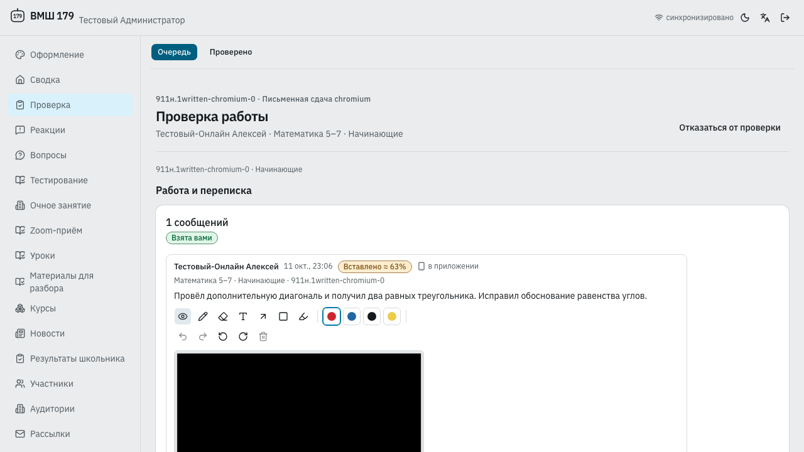

# Доля вставленного текста — проверка 11 октября 2026

Требование и интерфейсы: [paste-evidence.md](../../../vmshpwa/docs/paste-evidence.md).

## Проверка

- `make pwa-i18n-extract`: каталоги обновлены, три подписи переведены на английский.
- Последний полный backend: 2965 passed, 6 skipped; шесть существующих
  containment-проверок справочного корпуса явно исключены через
  `PYTEST_ADDOPTS=--deselect=...`.
- Format, types, JS/CSS lint, frontend/backend i18n прошли.
- После исправления привязки tooltip и теста фактического paste:
  targeted composer/badge — 5 passed.
- Frontend: **220 files, 1106 tests passed**.
- Storybook: **76 files, 376 scenarios passed**, включая новые состояния и a11y.
- Chromium E2E `review submissions`: **6 passed**, retries=0; production frontend
  build прошёл. Native paste, частичное удаление, reload, offline/reconnect,
  replacement и плашка 63% в реальном Staff review проверены.
- Скриншот просмотрен: процент находится в заголовке конкретного сообщения,
  warning-плашка читается и не нарушает layout.

Backend proof: `.runtime/vmshpwa/checks/20261011T194419.252433Z/python.log`.
Static proof: `.runtime/vmshpwa/checks/20261011T195125.024215Z/`.
Продолжение штатных шагов: `.runtime/vmshpwa/checks/paste-evidence-continuation/`.
В повторном запуске Python закончился временный диск; удалены только
созданные этой задачей `pytest-48` и `pytest-50`, освобождено около 6 ГиБ.
Бизнес-логика backend после успешного прогона не менялась; после финального
упорядочивания двух imports domain/API/review/move/clone перепроверены: 14 passed. После frontend-правок
static gates прошли повторно; незавершённые frontend/Storybook/E2E шаги
продолжены теми же командами штатного runner под его lock.

Это составной receipt успешных шагов, а не утверждение, что один полный
неограниченный gate завершился зелёным. WebKit/Firefox в этом запуске не проверялись.

Синтетическое окружение: pwa-e2e DB/media/NATS namespaces, Node 26.9.0,
pnpm 11.15.1, зависимости строго из lock-файлов. Пустой локальный
`creds_test/vmsh_bot_config_test.json` не содержит credentials. TeX доступен
через PATH; тесты не запускают Telegram polling и не используют production.

## Ограничение полного gate

Исключены только:

- `test_legacy_golden_corpus.py::test_committed_manifest_matches_every_corpus_file`
- `test_legacy_golden_corpus.py::test_manifest_has_only_non_content_metadata`
- `test_legacy_golden_corpus.py::test_validator_rejects_an_unreviewed_source_fingerprint`
- `test_content_characterization.py::test_content_characterization_is_current_and_content_free`
- `test_external_process_register.py::test_register_has_complete_typed_process_records_and_valid_links`
- `test_external_process_register.py::test_runbooks_are_ordered_and_reference_registered_processes`

Они требуют локальных копий `_vmsh_examples` и `_external_pipelines` в worktree.
Временные ссылки позволили остальные read-only проверки, но нарушают строгий
containment этих шести тестов. Автоматическая проверка разрешений отклонила
копирование возможных приватных материалов из основного репозитория.
Полный gate без исключений требует явного разрешения владельца на эти копии.
Это ограничение окружения, а не отключение тестов фичи.

Временные ссылки корпуса удалены после проверки; исходные файлы не менялись.
