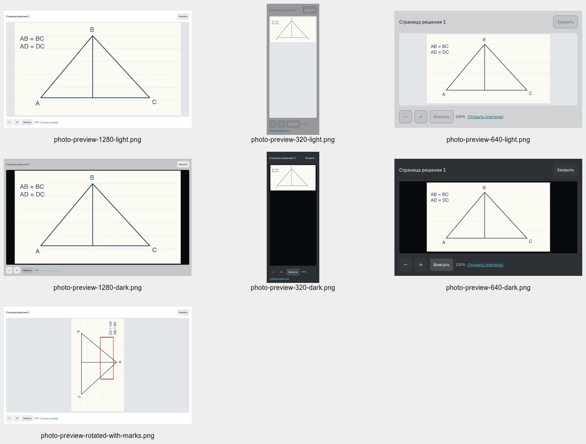
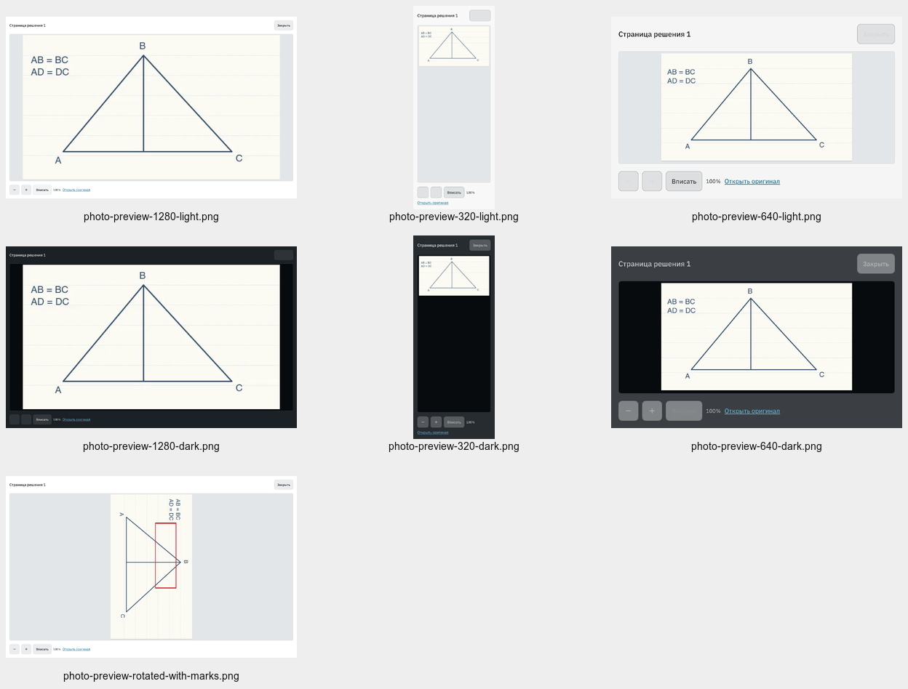
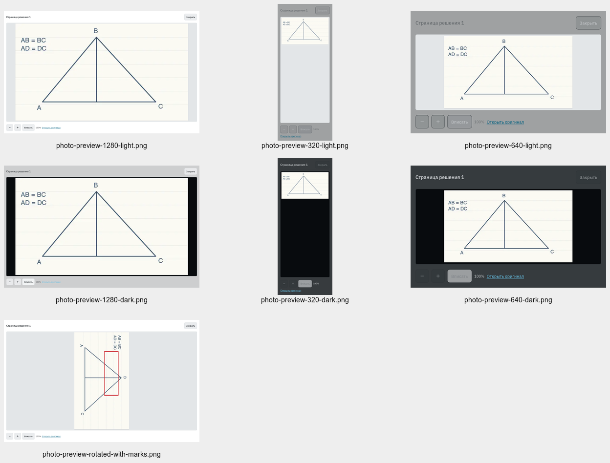

# Просмотр и копирование фото — 11 октября 2026

Реализованы [требования](../../../vmshpwa/docs/review-photo-preview.md):
оригинал в новой вкладке, просмотр на всё окно, масштаб 25–400%, начальный
режим просмотра и обычная разметка после выбора инструмента.

## Проверки

Команда: `make pwa-check-release PWA_E2E_MODES="review submissions"` — **PASS**.

- Python: 2955 PASS, 12 SKIP; frontend: 1091 PASS; Storybook: 373 PASS.
- E2E: 18 PASS в Chromium, WebKit и Firefox, без повторов.
- Format, types, JS/CSS lint, оба i18n check: PASS. Четыре app bundles проверены
  runner по SHA; валидный build cache переиспользован.
- [Receipt](summary.json): `source_changed=false`; [E2E receipt](e2e.json).
- [Сценарий](../../../vmshpwa/e2e/review-workspace.spec.ts) проверяет новую вкладку,
  декодирование фото, доступность исходника после завершения работы, попадание
  contextmenu в img без preventDefault, fit/zoom, прокрутку, Escape, возврат фокуса,
  сохранение/восстановление черновика и пометки.
- [Storybook](../../../vmshpwa/packages/product/src/review-annotation.stories.tsx)
  покрывает фото без комментариев, горизонтальную/вертикальную геометрию,
  повороты, совместимость прежних пометок и undo/redo.

Firefox выявил старую повреждённую 1px WebP fixture. Review seed теперь использует
существующий [синтетический рисунок](../../fixtures/student-results-photo.webp)
640×360. Авторизация, серверные заголовки, API и БД не менялись.

## Визуальный осмотр

Осмотрены 21 снимок: светлая/тёмная темы при 1280×800, 320×800 и 640×400,
а также поворот с пометкой. 640×400 моделирует доступный CSS viewport desktop
при 200% browser zoom; системный browser zoom отдельно не переключался.
Фото и пометки вписываются в окно; оригинал и управление масштабом доступны.
Снимки не являются обновлением baseline.

## Осталась ручная проверка

Выбор системного пункта «Копировать изображение» и вставка в графический редактор
не проверены: Mac заблокирован, native apps недоступны. Автоматизация проверяет
реальное попадание мыши в img и незаблокированный contextmenu. Само системное
меню не вызывается в E2E: его обработка следующих кликов различается между движками.
Встроенный браузер дополнительно использован для осмотра синтетического примера;
временный агентский Storybook и созданная вкладка после осмотра закрыты.
