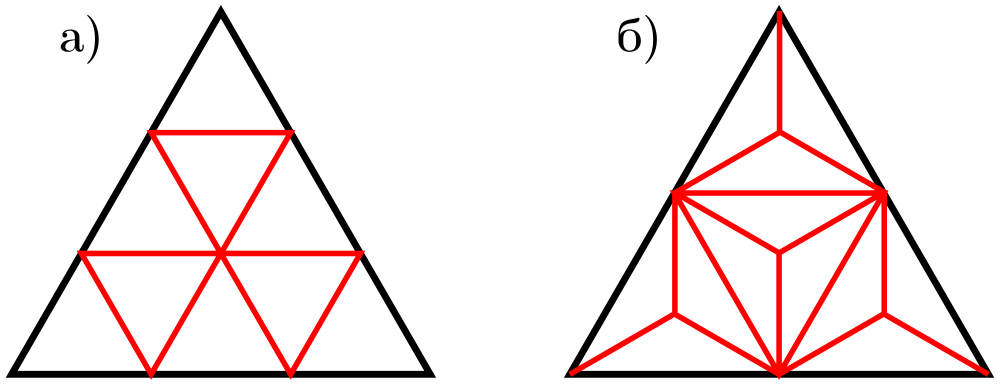

# Legacy `itemnum` в TikZ — 10 октября 2026

Полный пример владельца из `gl-16` закреплён в
[`triangle-dissection.tex`](../../fixtures/content/triangle-dissection.tex).
До исправления реальный production converter завершался с
`LaTeX Error: No counter 'itemnum' defined` на `\setcounter{itemnum}{0}`:
compatibility `\пункт` использовал отдельный `vmshpart`.

[`tikz.py`](../../../helpers/pwa/content/tikz.py) теперь создаёт legacy
`itemnum` при необходимости, сохраняет явное объявление и сброс счётчика,
использует русские буквенные подписи. Замена command tokens применяется к
производному source. Для `renewcommand` compatibility-макрос определяется
перед переопределением; `newcommand`, `providecommand` и `def` сохраняются.
[`compiler.py`](../../../helpers/pwa/content/compiler.py) повышен до generation
11 для новой revision при повторной загрузке ранее неудачного файла.

Реальный TeX→SVG: 609×235, 6008 bytes. Текст PDF содержит `а)` и `б)`;
оба треугольника и подписи осмотрены на белом фоне.
[SVG](triangle.svg), [PNG](triangle.png), [квитанция](conversion.json).



## Проверки

Финальный focused run — **202 PASS / 1 SKIP**:

```sh
PATH=/Library/TeX/texbin:$PATH .venv/bin/python -m pytest -o addopts= -q -n4 \
  pwa_tests/domain/test_content_tikz.py \
  pwa_tests/domain/test_content_assets.py \
  pwa_tests/domain/test_content_compiler.py \
  pwa_tests/domain/test_content_characterization.py \
  pwa_tests/integration/test_content_assets_smoke.py \
  pwa_tests/integration/test_content_http_api.py
```

Покрыты UTF-8/CP1251, два самостоятельных пункта условия и подсказки,
неизменный исходник, единственный общий рисунок, явное объявление/сброс,
реальные macro definitions и новая revision после compiler upgrade.
SKIP относится к отсутствующему owner-local корпусу фотографий.
Ruff и `git diff --check` — PASS.

Общий `make pwa-check-fast PWA_E2E_MODES=content`:
format/types/lint/i18n — PASS; Python — **2880 PASS / 7 SKIP / 7 FAIL**.
Один FAIL — устаревшая compiler characterization после изменения effective
TikZ source; отчёт обновлён и проверен финальным focused run. Изменения
четырёх golden sources ограничены AST/web hashes; исходные bytes, структура,
число задач, диагностики и Telegram output прежние. Шесть остальных FAIL
вызваны отсутствием `_external_pipelines` в новом worktree: reference workbook,
`a53_calc_rating_new.py`, inventory/runbook paths и Telegram export JSON.
Frontend unit, Storybook и Chromium E2E не начинались, общий gate не зелёный.

Полные логи: `.runtime/vmshpwa/tikz-itemnum-20261010/focused.log` и
`.runtime/vmshpwa/checks/20261010T181033.701576Z/`.
Production не обновлён.

[Контракт](../../../vmshpwa/docs/latex-content-pipeline.md#legacy-пункты-внутри-tikz--10-октября-2026).
